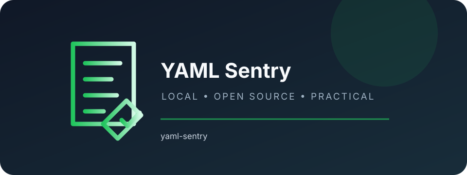

<p align="center"></p>
<p align="center"></p>
<p align="center">   </p>
<p align="center"></p>

## 🧭 Overview
YAML Sentry checks local YAML files for duplicate mapping keys and syntax errors. It reports problems without rewriting configuration files.

## ✨ Features
- 🔎 Detects duplicate mapping keys, including nested mappings.
- 📍 Reports file, line, and column locations.
- 📦 Supports human-readable and JSON output for scripts.
- 🛡️ Uses a safe YAML loader and never executes custom constructors.

## 🎬 Demo
```text
$ python main.py examples/duplicate.yaml
examples/duplicate.yaml:4:3: duplicate key 'port'
1 issue(s) found.
```
The example runs locally; no upload or hosted service is involved.

## 🚀 Quick Start
```bash
python -m pip install -r requirements.txt
python main.py examples/duplicate.yaml
```
Add `--json` for machine-readable output or `--strict` to exit with status 1 when issues are found.

## 🧰 Tech Stack
- Python 3.10+
- PyYAML safe parsing
- unittest regression tests

## 🗂️ Folder Structure
```text
main.py
yaml_sentry/loader.py
tests/test_loader.py
examples/duplicate.yaml
assets/overview.svg
requirements.txt
```

## 🗺️ Roadmap
- [x] Duplicate-key detection
- [x] Syntax-error locations
- [ ] Optional config-specific rule packs

## 🤝 Contributing
Issues and focused pull requests are welcome. Add regression tests for bug fixes and keep the checker read-only.

## 📄 License
Released under the [MIT License](LICENSE).

<p align="center"></p>
